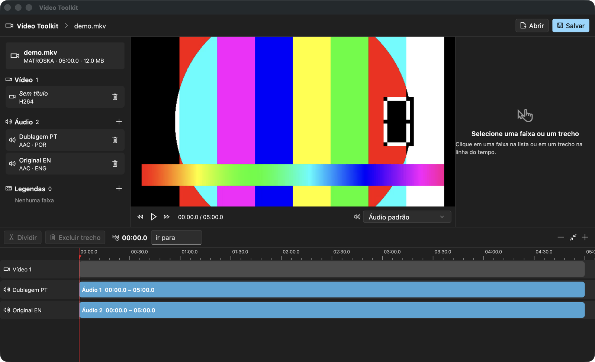
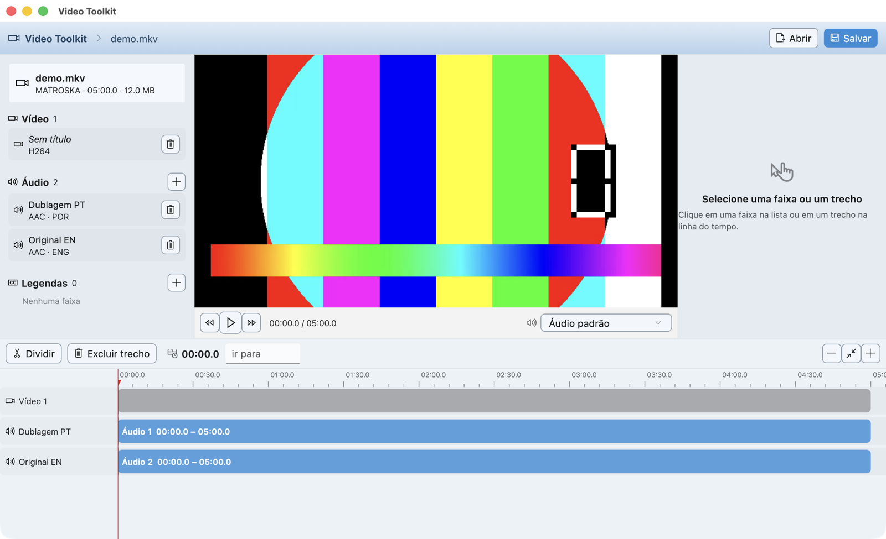

# Video Toolkit

**A desktop track editor for MP4 and MKV files — cut, merge, retime and remux
audio, video and subtitle tracks without re-encoding the video.**

[](https://github.com/omanoloneto/video-toolkit/releases)
[](https://github.com/omanoloneto/video-toolkit/actions)
[](LICENSE)


Video Toolkit gives you an NLE-style workspace — track list, video preview,
properties panel and a zoomable timeline — for the kind of surgery media
players can't do and full video editors make painful: swapping dub tracks,
fixing audio sync, stitching the good half of one track onto the other,
attaching subtitles, and exporting audio — all while the video stream is
copied bit-for-bit.



<details>
<summary>More screenshots</summary>



</details>

## Features

- **Track management** — list every video, audio and subtitle track with
  codec, language and channel details; add external audio (`mp3`, `aac`,
  `m4a`, `ac3`, `eac3`, `flac`, `wav`, `opus`, `ogg`, `dts`, `mka`) and
  subtitle files (`srt`, `ass`, `ssa`, `vtt`, `sub`); remove, restore and
  rename tracks; export any audio track losslessly.
- **Timeline editing** — split audio tracks into segments, delete pieces,
  drag them along a zoomable timeline with playhead snapping, or type exact
  times (`90`, `1:30`, `1:02:03.5`). Drag the edge of any piece to shrink or
  stretch it for fine adjustments: audio stops where its source ends or
  where the neighbouring piece begins, and edges snap to the playhead and to
  video cuts. Audio lanes show the waveform of their source.
- **Merge on save** — tracks that were cut apart are automatically
  mixed into a single output track at their timeline positions (e.g. the
  first 3 minutes of track 1 followed by the rest of track 2). Untouched or
  merely delayed tracks stay separate. The merge button on each audio lane
  (or the checkbox in the properties panel) overrides that: include a whole
  track — say, an opening song placed before the dub — or keep a cut one
  separate.
- **Video cutting and inserting** — split the video lane (`S`) and remove a
  piece: its audio and subtitles go with it and everything after moves back,
  so nothing falls out of sync. Insert another video file at the playhead
  (opening, ending...): it is fitted into the original frame, its sound fills
  the gap in every audio track and the rest moves forward. Dragging the edge
  of a video piece trims or brings back footage the same way, with the
  audio and subtitles of that stretch. Cuts are frame-exact, so an edited
  video is always re-encoded on save.
- **Compact formats** — on save, keep the original picture or re-encode to
  **AV1** (SVT-AV1, about half the size at the same quality — VMAF ≈ 96.5 on
  1080p anime) or **H.265** (plays on more devices, much slower to encode).
  Lossless audio (FLAC, PCM...) becomes AAC 256 kb/s when compacting.
- **Built-in preview of the edit** — playback powered by
  [media_kit](https://pub.dev/packages/media_kit)/libmpv plays the edited
  program, not the original file: cuts, inserted videos, trimmed or moved
  audio, silent gaps and merged tracks sound the way they will be saved. The
  program is assembled as an mpv EDL from single-stream copies of the audio
  tracks, rebuilt a moment after each edit. Choose which track to monitor —
  including external files; a merged track plays the whole merge.
- **Lossless by default** — video is always stream-copied. Untouched audio
  is copied too (pure delays use `-itsoffset`, head trims use `-ss`); only
  edited audio lanes are re-encoded (AAC 256k) through an ffmpeg filter
  graph (`atrim` → `asetpts` → `aresample` → `adelay` → `amix`).
- **Safe saving** — output is always rendered to a temporary file and moved
  into place afterwards, so overwriting the source can never corrupt it.
  Container incompatibilities (e.g. image-based subtitles into MP4) are
  detected and confirmed before anything runs.
- **10 themes** — looks inspired by Windows 98 / XP / Vista / 7 (Aero) /
  8 / 10 / 11, classic and modern macOS, and Ubuntu. Each theme swaps
  colors, corner radii, button styles and the icon family (Fluent, Cupertino
  or Material); glass themes enable real window translucency on macOS.
- **Desktop-first** — landscape-only layout, native macOS menu bar with
  shortcuts, keyboard-driven editing.

## Download

Grab the latest build from the
[Releases page](https://github.com/omanoloneto/video-toolkit/releases):

| Platform | File | Notes |
| --- | --- | --- |
| macOS | `VideoToolkit-<version>-macos.zip` | Unzip, drag to Applications. The build is not notarized, so macOS blocks it on first launch — see [Opening on macOS](#opening-on-macos). |
| Windows | `VideoToolkit-<version>-windows.zip` | Unzip anywhere, run `video_toolkit.exe`. |
| Linux (Debian/Ubuntu) | `video-toolkit_<version>_amd64.deb` | `sudo apt install ./video-toolkit_<version>_amd64.deb` |

**FFmpeg is required on every platform** — Video Toolkit drives `ffmpeg` and
`ffprobe` under the hood:

```sh
# macOS            # Windows                # Debian/Ubuntu
brew install ffmpeg  winget install ffmpeg    sudo apt install ffmpeg
```

The `.deb` package already declares FFmpeg as a dependency.

### Opening on macOS

Release builds are ad-hoc signed, not notarized. Since macOS 15 the old
right-click → Open trick is gone and macOS refuses to run a downloaded copy.
Allow it once, either way:

- **System Settings → Privacy & Security**, scroll to the message about
  Video Toolkit and click **Open Anyway**; or
- remove the download quarantine in Terminal:

  ```sh
  xattr -dr com.apple.quarantine "/Applications/Video Toolkit.app"
  ```

Builds you compile yourself (`flutter build macos`) are never quarantined.

## Keyboard shortcuts

| Key | Action |
| --- | --- |
| `Space` | Play / pause the preview |
| `S` | Split the selected track's segment at the playhead |
| `Delete` / `Backspace` | Delete the selected segment (or the whole selected track) |
| `⌘O` | Open a video (macOS menu bar) |
| `⌘S` | Save (macOS menu bar) |

## How saving works

Everything is delegated to FFmpeg as an external process — the app builds a
single command per save:

1. **Untouched tracks** are mapped with `-c copy` (bit-perfect remux).
2. **Whole-track shifts** stay on the copy path: positive delays become
   `-itsoffset`, head trims become `-ss` on a duplicate input.
3. **Edited lanes** (split / trimmed / merged) are assembled with
   `-filter_complex`: each segment is `atrim`-ed, re-timed and `adelay`-ed
   to its timeline position, then all segments are mixed with `amix` and
   encoded to AAC.
4. An edited video becomes one input per piece (`-ss` to its start), cut
   exactly with `trim`, scaled and padded into the original frame when it
   comes from another file, and joined with `concat`; chapters are dropped
   because they would point to the wrong places. Subtitles cut by the edit
   are extracted, their cues moved piece by piece, and muxed back.
5. Subtitles are converted when the target container demands it (`srt` →
   `mov_text` for MP4, exotic text formats → `srt` for MKV); image-based
   subtitles that cannot exist in MP4 are dropped with an explicit warning.
   MKV outputs also keep font attachments so ASS subtitles render correctly.

## Building from source

Requirements: [Flutter](https://flutter.dev) (stable channel) and FFmpeg.

```sh
git clone https://github.com/omanoloneto/video-toolkit.git
cd video-toolkit
flutter pub get

# run in debug
flutter run -d macos      # or -d windows / -d linux

# release build (the app also accepts a video path as CLI argument)
flutter build macos --release
open "build/macos/Build/Products/Release/Video Toolkit.app" --args ~/movie.mkv
```

Platform notes:

- **macOS** — the App Sandbox is disabled in the entitlements so the app can
  execute FFmpeg and read arbitrary files. Window translucency uses
  `macos_window_utils` (NSVisualEffectView).
- **Linux** — needs the usual Flutter desktop toolchain plus
  `libgtk-3-dev` and `libmpv-dev`.
- **Windows** — Visual Studio C++ workload, per standard Flutter setup.

Releases for all three platforms are produced by the GitHub Actions workflow
in [.github/workflows/release.yml](.github/workflows/release.yml), triggered
by pushing a `v*` tag.

## Tests

```sh
flutter test            # unit + widget tests (ffmpeg command assembly, timeline, themes)
dart run tool/e2e.dart  # end-to-end against a real ffmpeg: generates media,
                        # saves through the app's pipeline and verifies the
                        # output content (stream counts, durations, which
                        # audio plays before/after a cut)
flutter test integration_test -d macos  # runs the real app: trims audio and
                        # video by their edges and checks what libmpv loads
                        # and plays
```

## Project layout

```
lib/
  models/tracks.dart          # tracks, audio segments, split/merge rules
  models/program.dart         # ripple cuts/inserts, edge trims, snapshots
  services/ffmpeg_service.dart# probing + ffmpeg command construction
  services/audio_cache.dart   # per-track audio copies, waveforms, silence
  services/preview_plan.dart  # what the preview plays (mpv EDL)
  screens/editor_screen.dart  # app shell, menu bar, playback state
  widgets/timeline_panel.dart # timeline: lanes, clips, ruler, playhead
  widgets/preview_panel.dart  # video preview + audio monitoring
  widgets/properties_panel.dart
  theme/app_themes.dart       # the 10 theme definitions
  theme/theme_icons.dart      # Fluent / Cupertino / Material icon sets
tool/e2e.dart                 # real-ffmpeg end-to-end checks
integration_test/             # the real app driving libmpv
assets/icon/                  # icon source art
```

The theme choice is persisted to `~/.video_toolkit/theme.txt`.

## License

[MIT](LICENSE)
